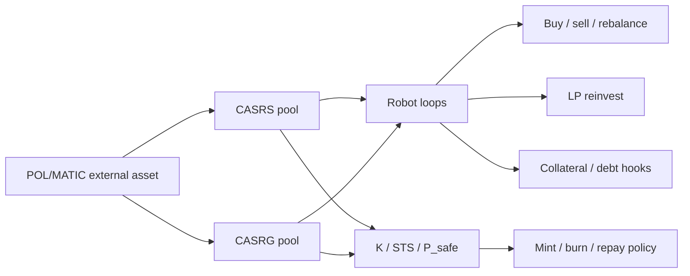

# 💸 SYNERGY CASHERO — verified technical & evidence dossier

> **Статус:** 🔴 **SECURITY_BLOCKED** для deployment/federation promotion до ротации и очистки committed credentials.
> **Технический профиль:** Solidity + Python/Web3 bots + deterministic AMM/system simulations + research reports.
> **Проверено по фактическому `main`, ключевым исходникам и сохранённым reports:** 29.09.2026.

## 1. 🎯 Что это за repository

`synergy_cashero` — mixed financial/monetary R&D repository вокруг двухконтурной токенной модели, AMM/LP, CASRS/CASRG contracts, циклических роботов и проверки того, может ли механика давать устойчивый результат без подмены внутренней переоценки реальной прибылью.

Этот repo нельзя описывать как один «бот»: в нём одновременно находятся:

- Solidity contracts нескольких поколений;
- Web3 Polygon bot;
- deterministic simulators;
- parameter search;
- saved JSON/Markdown reports;
- legacy economic-system scripts;
- deployment/config material.

## 2. 📦 Фактический состав `main`

Ключевые элементы:

```text
CASRGv2.sol
CASRSv2.sol
contracts/
  CASRGv3.sol
  CASRSv3.sol
v3/
  contracts/
  cashero_v3_bot.py
  hardhat.config.js
  package.json
cashero_v3_bot.py
real_polygon_cyclic_robot.py
simulate_our_robot_150.py
simulate_real_robot_aggregate.py
run_exact_150_cycles.py
optimize_robot_profitability.py
top_cyclic_robot.py
sinergia_bot.py
sinergia_system.py
SINERGY SYSTEM FINANSE ECOSYSTEM*.py
exact_150_cycles_report.json/.md
our_robot_exact_150_report.json/.md
real_robot_aggregate_150_report.json/.md
robot_param_search_*.json/.md
mainnet-addresses.json
.env / owner.env / bot1.env / bot2.env
```

Есть также исторические DOCX-материалы по двухконтурной платёжной системе.

## 3. 🚨 Критический security finding

На `main` committed credential-like files:

```text
.env
owner.env
bot1.env
bot2.env
```

Повторный аудит подтвердил, что в них присутствует **неплейсхолдерное private-key / credential-like material**. Значения намеренно не приводятся здесь.

Это означает:

```text
credential committed to Git
=> treat as compromised
```

даже если файл позже удалить из текущего HEAD, потому что material может оставаться в Git history, forks, caches или локальных clones.

### Обязательная remediation до любого deployment

1. немедленно rotate/revoke потенциально реальные private keys;
2. перевести on-chain authority/funds на новые keys при необходимости;
3. заменить tracked env-файлы placeholder examples;
4. удалить secret material из current tree;
5. purge sensitive Git history, где применимо;
6. включить secret scanning;
7. добавить pre-commit/CI secret detector;
8. доказать, что никакой bot/deployment больше не зависит от старых credentials.

Канонический blocker записан в `Shtenco/synergy_system/registry/SECURITY_BLOCKERS.json`.

## 4. 🏗️ Архитектурная идея

Репозиторий исследует два связанных token/financial contours.

Упрощённо:



Экономически важная граница:

```text
token mark-up != external wealth
LP reserve increase != owner free cash
mint != profit
internal NAV model != consolidated HardNAV unless claims are economically valid
```

## 5. 🤖 Реальный Web3 bot path

`cashero_v3_bot.py`:

- подключается к Polygon RPC;
- использует chainId 137;
- работает с QuickSwap-style router address;
- читает private keys из local env files;
- создаёт owner/bot1/bot2 accounts;
- выполняет sequential buys;
- затем partial sells;
- вызывает model hooks:
  - `updateState`;
  - `mintByGrowth`;
  - `robotSellReserveAndAddLiquidity`;
- имеет optional `mintAgainstCollateral` debt loop;
- работает бесконечным loop с sleeps.

### Критическая оговорка в самом коде

Перед `updateState` есть комментарий:

```text
NOTE: set real X/Y/F/B/C/R values from oracle/indexer in production
```

Но текущий bot передаёт hard-coded model values:

```text
1000, 500, 500, 100, 100, 1000, 2000, 200, prev_twap
```

Следовательно этот path **не должен считаться production economic oracle integration**.

## 6. 🔐 Execution risks текущего bot

В inspected code есть несколько production blockers:

- private keys читаются из файлов;
- default public RPC fallback;
- fixed addresses/default zero-like contract placeholders для CASRS/CASRG при отсутствии env;
- `amountOutMin = 0` в router swaps;
- нет slippage protection;
- waits синхронные;
- optional debt-loop exception проглатывается;
- state inputs hard-coded;
- бесконечный execution loop;
- нет persistent idempotency/reconciliation ledger.

Поэтому наличие real Web3 calls ≠ безопасная production готовность.

## 7. 🧮 Deterministic AMM simulator

`simulate_our_robot_150.py` содержит x·y=k-style Pair:

[
k = xcdot y
]

Buy operation применяет fee:

[
input_{eff}=input(1-fee)
]

и пересчитывает reserves через invariant.

Simulation хранит wallets, RS/RG pools, supply, TWAP-like history и рассчитывает:

- `P_spot`;
- `P_twap`;
- `P_safe`;
- `K`;
- `STS`;
- total NAV;
- PnL;
- ROI;
- max drawdown;
- LP reserve growth.

## 8. 📐 Модельные метрики

В inspected simulator:

[
P_{spot}=rac{Y}{X}
]

24-point price history используется для simple TWAP.

Stress exit liquidity рассчитывается через sale of fraction (
ho F), затем:

[
P_{safe}=min(P_{twap},P_{exit})
]

Далее из reserve/model variables строятся `K` и `STS`.

Эти метрики являются **внутренними model variables**, не audited external solvency measures.

## 9. 📊 Сохранённые evidence reports: противоречивые результаты

Это важнейшая часть repository, которую README обязан показывать полностью.

### A. `exact_150_cycles_report.json`

Сохранённый report заявляет очень большой model NAV growth:

- 150 cycles;
- seed 42;
- model NAV PnL ≈ **91,655.45 MATIC**;
- reported NAV ROI ≈ **78,130%**.

Но этот результат нельзя автоматически считать внешней реализуемой прибылью. Он зависит от model accounting/price dynamics и требует проверки против consolidated external assets/liabilities.

### B. `our_robot_exact_150_report.json`

Для deterministic simulation существующего robot logic:

- initial NAV = **145 MATIC**;
- final NAV ≈ **144.77545 MATIC**;
- PnL ≈ **−0.22455 MATIC**;
- ROI ≈ **−0.15486%**;
- max drawdown ≈ **0.15512%**.

То есть конкретная inspected configuration дала **отрицательный** result.

### C. `real_robot_aggregate_150_report.json`

Другой aggregate model показывает:

- aggregate start = **280,050 MATIC**;
- aggregate end ≈ **280,058.1941 MATIC**;
- delta ≈ **+8.1941 MATIC**.

Но значительная часть результата находится в pool reserves, а wallets уменьшились. Это требует ownership/consolidation analysis, прежде чем называть delta прибылью владельца.

### D. Parameter search

`robot_param_search_summary.md`:

- **21,600 runs**;
- fully feasible condition:
  - profit;
  - both LP pools grow;
  - DD <=1%;
- **fully feasible runs = 0**.

Top candidates всё ещё имели небольшой отрицательный PnL около **−0.025735 MATIC**.

Это сильный отрицательный evidence и он важнее выборочной демонстрации удачного model report.

## 10. 🛡️ Экономические инварианты

```text
mint != profit
burn != profit
token price increase != external cash
LP reserve growth != owner distributable P&L
pool asset != automatically owner-free asset
new collateral debt != income
internal transfer != consolidated income
simulated NAV != realized HardNAV
aggregate pool delta != wallet profit
```

Для честной оценки нужен owner/consolidated balance sheet.

## 11. 📥 Inputs

В зависимости от path:

### Web3 bot
- RPC;
- contract addresses;
- private keys;
- on-chain balances;
- TWAP/state values;
- gas price;
- router liquidity.

### Simulation
- pool reserves;
- wallet balances;
- token supply;
- config parameters;
- fees;
- cycle count;
- random seed/model rules.

## 12. 📤 Outputs

- on-chain tx hashes (real bot path);
- balances/state changes;
- deterministic simulation reports;
- NAV/PnL/DD;
- LP reserve growth;
- K/STS/Psafe;
- parameter search ranking.

## 13. 🧪 Evidence hierarchy

```text
source code
< deterministic unit/simulation
< historical replay
< fork/testnet
< observed mainnet transaction
< reconciled external cashflow
< audited consolidated P&L
```

Текущий repository содержит первые уровни и потенциально mainnet-oriented bot code, но README не объявляет audited external P&L.

## 14. ⚠️ Главные modeling risks

1. internal token marks inflate NAV;
2. LP ownership may be ambiguously attributed;
3. debt/collateral can be mistaken for assets without liability;
4. hard-coded state variables break real-world parity;
5. zero minOut removes price protection;
6. aggregate pool growth may merely shift value from wallets;
7. simulation liquidity may ignore MEV/latency/price impact beyond simplified AMM;
8. historical/external market path is not necessarily used;
9. smart-contract security not established merely by source presence.

## 15. 🧪 Required next tests

### Accounting
- consolidated double-entry ledger;
- owner vs protocol vs user asset ownership;
- liabilities;
- LP token ownership;
- realized/unrealized split.

### Smart contracts
- invariant/property tests;
- access control;
- mint caps;
- reentrancy;
- price/oracle manipulation;
- flash-loan attack;
- emergency pause;
- collateral solvency.

### Bot
- no hard-coded production state;
- minOut/slippage;
- nonce race/retry;
- idempotency;
- crash recovery;
- tx replacement;
- RPC outage;
- chain reorg.

### Simulation
- exact historical external prices;
- gas;
- MEV/slippage;
- Monte Carlo;
- OOS parameter selection;
- external-value reconciliation.

## 16. 🛠️ Reproducibility

Simulation path can be reproduced from source, for example:

```bash
git clone https://github.com/Shtenco/synergy_cashero.git
cd synergy_cashero
python simulate_our_robot_150.py
```

Но saved outputs should be compared byte/field-wise to regenerated evidence.

**Do not run the live Web3 bot with committed credentials.** Credentials must be rotated first.

## 17. 🗺️ Repository map

| Area | Purpose |
|---|---|
| `CASRSv2.sol`, `CASRGv2.sol` | legacy contract generation |
| `contracts/*v3.sol` | V3 contracts |
| `v3/` | V3 package/deployment layout |
| `cashero_v3_bot.py` | Polygon-oriented execution bot |
| `simulate_our_robot_150.py` | deterministic robot simulation |
| `simulate_real_robot_aggregate.py` | aggregate model |
| `optimize_robot_profitability.py` | parameter search |
| `*_report.json/md` | saved evidence |
| `*.env` | 🔴 committed credential risk |
| legacy finance scripts | historical prototypes |
| DOCX | historical design documentation |

## 18. 🔗 Место в SYNERGY

CASHERO belongs to finance/monetary R&D and should feed accounting evidence into:

- [`synergy_financial_os`](https://github.com/Shtenco/synergy_financial_os);
- [`synergy_pay_system`](https://github.com/Shtenco/synergy_pay_system);
- monetary/bridge research repos.

It must **not** define consolidated HardNAV by itself.

## 19. 📊 Current evidence maturity

| Layer | Status |
|---|---|
| Solidity sources | ✅ present |
| Python bots | ✅ present |
| deterministic simulators | ✅ |
| saved reports | ✅ |
| parameter search | ✅ |
| negative evidence preserved | ✅ |
| secure credential handling | 🔴 FAIL |
| production oracle/state inputs | ❌ |
| audited contract security | ❌ |
| consolidated external P&L | ❌ |
| safe production deployment | 🔴 BLOCKED |

## 20. 🚀 Roadmap

1. rotate every exposed credential;
2. purge secrets/current tree/history;
3. enable secret scanning;
4. establish owner/protocol/user accounting;
5. repair live bot slippage/idempotency/oracle path;
6. property-test V3 contracts;
7. regenerate 150-cycle reports with exact provenance;
8. add historical external price/gas paths;
9. strict OOS parameter optimization;
10. reconcile every positive result to external owned assets;
11. only after security + evidence gates reconsider federation promotion.

## 21. 🛑 Что проект НЕ утверждает

- что saved +78k% model ROI является realized external profit;
- что 150-cycle aggregate pool growth принадлежит владельцу;
- что robot currently profitable;
- что parameter search нашёл feasible profitable configuration — он **не нашёл**;
- что contracts audited;
- что committed keys безопасны;
- что production deployment разрешён;
- что mint/LP mechanics создают бесплатное wealth.

## 22. 🎯 Формальная проблема, которую должен решать CASHERO

Главный научный вопрос repository не «как заставить внутренние числа расти», а:

> может ли система после учёта ownership, liabilities, external executable prices, fees/gas and settlement показать положительный **consolidated external owner/protocol result**, который воспроизводится вне замкнутой внутренней переоценки?

Именно поэтому отрицательные simulation reports и отсутствие fully-feasible parameter runs считаются полезным evidence, а не неудачей, которую надо скрыть.

---

[🧭 SYNERGY SYSTEM](https://github.com/Shtenco/synergy_system) · [🔐 Security blockers](https://github.com/Shtenco/synergy_system/blob/main/registry/SECURITY_BLOCKERS.json) · [📚 Atlas](https://github.com/Shtenco/synergy_system/blob/main/docs/SYNERGY_REPOSITORY_ATLAS.md)
