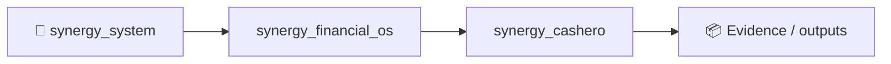
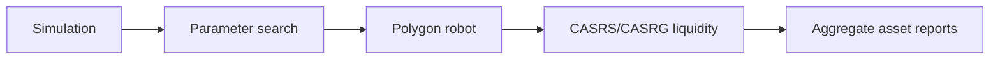

# cashero

## TOP cyclic robot model (simulation)

Добавлены:

- `top_cyclic_robot.py` — симулятор циклического робота на 3 кошелька:
  - поочерёдная покупка,
  - поочерёдная частичная фиксация прибыли,
  - обязательное добавление ликвидности в оба токена,
  - адаптивная эмиссия и сжигание.
- `MODEL_TOP_CYCLIC_ROBOT.md` — математическая постановка и формулы.

Запуск:

```bash
python top_cyclic_robot.py
```

## Real multi-RPC robot (live trading)

- `real_polygon_cyclic_robot.py` — реальный робот для Polygon c:
  - ротацией нескольких RPC (`RPC_POLYGON_LIST`),
  - поочерёдными действиями с 3 кошельков (`owner.env`, `bot1.env`, `bot2.env`),
  - рандомными задержками между кошельками,
  - поочерёдной покупкой и частичной фиксацией,
  - обязательным LP-реинвестом в пару `CASRS/WMATIC` через `addLiquidityETH`,
  - фиксированной покупкой **1 POL** каждым кошельком за цикл.

Пример запуска:

```bash
export RPC_POLYGON_LIST="https://polygon-rpc.com,https://polygon-bor-rpc.publicnode.com,https://rpc.ankr.com/polygon"
export REAL_TAKE_PROFIT=0.20
export REAL_LP_INVEST_MATIC=0.05
export MIN_WALLET_DELAY_SEC=2
export MAX_WALLET_DELAY_SEC=8
python real_polygon_cyclic_robot.py
```

⚠️ Скрипт отправляет реальные транзакции. Сначала запускайте на минимальных объёмах.

Примечание: размер покупки у live-бота зафиксирован в коде как `1 POL` на кошелёк за цикл.

Форматы ключей, которые поддерживает `real_polygon_cyclic_robot.py`:
- `owner.env`: `PRIVATE_KEY=...`
- `bot1.env`, `bot2.env`: можно как `PRIVATE_KEY=...`, так и просто одной строкой с приватным ключом.


## Exact simulation of current bot logic (150 cycles)

Для симуляции **именно текущей логики** `sinergia_bot.py` (правила `strategy_step`) без RPC:

```bash
python simulate_our_robot_150.py
```

Скрипт сохраняет:
- `our_robot_exact_150_report.md`
- `our_robot_exact_150_report.json`


Параметрический подбор под стабильность/прибыль:

```bash
python optimize_robot_profitability.py
```

Рекомендации: `HOW_TO_MAKE_ROBOT_STABLE_PROFITABLE.md`.


## Simulation of REAL robot aggregate assets (wallets + both pools)

Чтобы проверить, растёт ли сумма активов в POLYGON для:
- всех кошельков,
- пула `CASRS/WMATIC`,
- пула `CASRG/WMATIC`,

запустите:

```bash
python simulate_real_robot_aggregate.py
```

Отчёты:
- `real_robot_aggregate_150_report.md`
- `real_robot_aggregate_150_report.json`


## V3 отдельная папка (контракты + deploy + liquidity + bot)

Все файлы для v3 собраны в `v3/`:
- контракты,
- install script для Hardhat,
- deploy script,
- скрипт добавления ликвидности по **10 POL в каждый пул**,
- бот v3.

См. инструкции: `v3/README.md`.


<!-- SYNERGY-FEDERATION-PASSPORT:START -->
---

## 🧭 SYNERGY federation passport

**Домен:** 💰 Finance / cash-flow R&D  
**Архитектурный родитель:** [`synergy_financial_os`](https://github.com/Shtenco/synergy_financial_os)  
**Архитектурный корень:** [`synergy_system`](https://github.com/Shtenco/synergy_system)



Эта диаграмма фиксирует место в документационной федерации. Реальная code/runtime dependency должна подтверждаться отдельными артефактами.

### Навигация

- [📚 Атлас всех 75 репозиториев](https://github.com/Shtenco/synergy_system/blob/main/docs/SYNERGY_REPOSITORY_ATLAS.md)
- [🧾 Машиночитаемый registry](https://github.com/Shtenco/synergy_system/blob/main/registry/SYNERGY_REPOSITORIES.json)
- [🧭 SYNERGY SYSTEM](https://github.com/Shtenco/synergy_system)

### Evidence rule

`GREEN` присваивается только воспроизводимым утверждениям. Исследовательский код, диаграмма или заявленная метрика без проверяемого artifact trail остаются `R&D/CANDIDATE`.

<!-- SYNERGY-FEDERATION-PASSPORT:END -->

---

# 💰 Глубокий доказательный паспорт Cashero

## Фактический профиль

Cashero сочетает симуляторы циклической ликвидности, parameter search, live Polygon robot и V3 contracts/deploy scripts.



## Критический security boundary

В `main` присутствуют `.env`, `owner.env`, `bot1.env`, `bot2.env`. Даже если текущие значения тестовые, **секретные ключи не должны храниться в Git**. Любой когда-либо committed private key следует считать потенциально скомпрометированным.

## Economic boundary

Обязательное добавление собственной ликвидности, покупки между собственными кошельками и token appreciation не должны считаться external profit. Правильная метрика — consolidated external assets minus external liabilities/costs.

## Следующий рубеж

- удалить/rotate secrets;
- deterministic simulation vs live parity;
- gas + slippage + tax accounting;
- consolidated wallet+LP ledger;
- external-counterparty-only PnL decomposition;
- live execution disabled by default.
