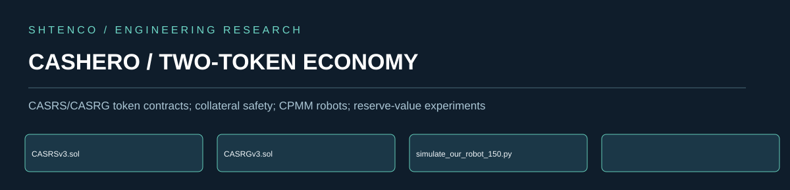

**CASRS/CASRG token contracts; collateral safety; CPMM robots; reserve-value experiments**

# CASHERO / TWO-TOKEN ECONOMY

## Original research direction

The architecture studies collateralized token issuance, repayment and liquidation, constant-product pools, a two-token reserve system, cyclic trading and deterministic 150-cycle simulations. Solidity CASRGv3 exposes userCR, mintAgainstCollateral, repay and liquidate; Python Pair models fee-adjusted pool swaps and reserve changes.

## Implemented engineering and algorithmic value

Historical synthetic pool returns are not externally realized income. Tracked configuration files might include secrets; rotation is essential before mainnet. Keep on-chain authority and reserve accounting explicit.

## Scientific and mathematical interpretation

Build conservation-ledger tests for token and external assets, stress collateral ratios and liquidation, compare taxed/no-tax contours, and require fork-state execution reports before on-chain promotion.

## Research and application opportunities

undefined

## Evidence context and development maturity

For a fee-adjusted CPMM with reserves x and y, input delta_y and fee f, output delta_x = x*delta_y*(1-f)/(y+delta_y*(1-f)) before integer rounding and transfer taxes. Gross mark-to-market value must not be mistaken for realized hard reserves.

## Source navigation

- [`contracts/CASRSv3.sol`](contracts/CASRSv3.sol)
- [`contracts/CASRGv3.sol`](contracts/CASRGv3.sol)
- [`simulate_our_robot_150.py`](simulate_our_robot_150.py)
- [`simulation/`](simulation/)
- [`exact_150_cycles_report.json`](exact_150_cycles_report.json)

## Publication protocol

Claims must refer to the exact current source commit or an identified experiment artifact. Source code establishes implementation; experiments require frozen inputs, complete costs, successful repeated checks and a labelled evaluation regime. Financial values are attributed to their measurement environment. This page is a scientifically grounded overview and is not an offer of investment returns.
